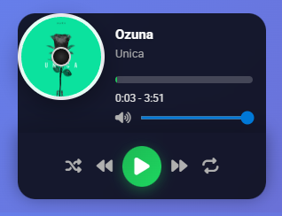

# Mini Music Player - Extensión de Chrome

Extensión de Chrome que convierte el reproductor de música web en un popup compacto y funcional.

## Instalación
1. Abre Chrome y ve a `chrome://extensions/`
2. Activa "Modo de desarrollador"
3. Clic en "Cargar extensión sin empaquetar"
4. Selecciona esta carpeta `extens`

## Características
- Reproductor compacto (320x400px)
- 3 canciones de Ozuna preconfiguradas
- Controles: play/pause, anterior, siguiente
- Barra de progreso interactiva
- Animación del disco al reproducir

## Archivos
- `manifest.json` - Configuración de extensión
- `popup.html` - Interfaz del reproductor
- `popup.css` - Estilos optimizados
- `popup.js` - Funcionalidad completa

## Uso
Haz clic en el ícono de la extensión para abrir el reproductor y disfrutar de la música.

## Captura de Pantalla
Aquí tenemos la captura de pantalla del proyecto:

