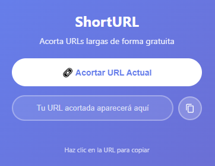

# ShortURL - Acortador de URL

Extensión de Chrome para acortar URLs de forma rápida y sencilla usando la API de TinyURL.

## Características

- ✅ Acorta la URL de la pestaña activa con un clic
- 📋 Copia automáticamente al portapapeles
- 🎨 Interfaz moderna con gradiente
- 🚀 Rápido y ligero
- 🔒 Solo requiere permisos de pestaña activa

## Instalación

1. Descarga o clona este repositorio
2. Abre Chrome y ve a `chrome://extensions/`
3. Activa el "Modo de desarrollador"
4. Haz clic en "Cargar extensión sin empaquetar"
5. Selecciona la carpeta del proyecto

## Uso

1. Navega a cualquier página web
2. Haz clic en el icono de la extensión
3. Presiona "🔗 Acortar URL Actual"
4. La URL acortada se copiará automáticamente al portapapeles

## Estructura del proyecto

```
shortURL extens/
├── manifest.json    # Configuración de la extensión
├── popup.html       # Interfaz de usuario
├── popup.js         # Lógica de la extensión
├── style.css        # Estilos de la interfaz
└── img/            # Iconos (16x16, 48x48, 128x128)
```

## Tecnologías

- **Manifest V3** - Última versión de extensiones de Chrome
- **TinyURL API** - Servicio de acortamiento de URLs
- **CSS3** - Gradientes y animaciones modernas
- **JavaScript ES6** - Fetch API y async/await

## Permisos

- `activeTab` - Para acceder a la URL de la pestaña actual

## Captura de Pantalla
Aquí tenemos la captura de pantalla del proyecto:

