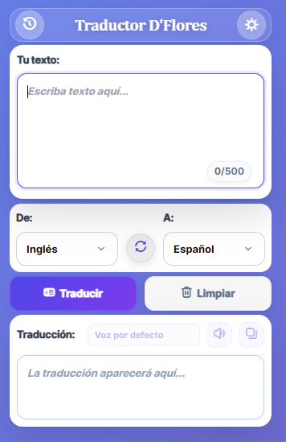

# Traductor D'Flores

Extensión de Chrome para traducir texto entre 75+ idiomas con síntesis de voz y diseño moderno.

## ✨ Características

- **75+ idiomas** con API MyMemory
- **Síntesis de voz** con múltiples voces
- **Tema claro/oscuro** con persistencia
- **Historial** de últimas 10 traducciones
- **Interfaz glassmorphism** profesional
- **Atajos de teclado** (Ctrl+Enter)

## 🚀 Instalación

1. Descargar el proyecto
2. Ir a `chrome://extensions/`
3. Activar "Modo desarrollador"
4. Hacer clic en "Cargar descomprimida"
5. Seleccionar la carpeta del proyecto

## 🎯 Uso

1. **Escribir** texto (máx. 500 caracteres)
2. **Seleccionar** idiomas de origen y destino
3. **Traducir** con botón o Ctrl+Enter
4. **Reproducir** audio con selector de voces
5. **Copiar** resultado al portapapeles

## Captura de Pantalla
Aquí tenemos la captura de pantalla del proyecto:

